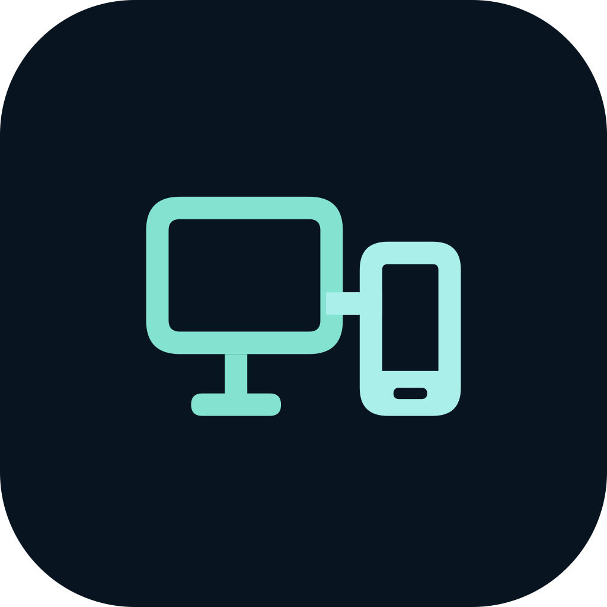

<div align="center">
  
  <h1>DualScreen</h1>
  <p><strong>Превратите Android-планшет во второй экран Mac по USB или Wi-Fi.</strong></p>
  <p>Расширение рабочего стола и Retina-зеркало · звук · управление с планшета</p>
  <p>
    <a href="https://github.com/oproskyrin/DualScreenPOI/releases/latest"></a>
    <a href="https://github.com/oproskyrin/DualScreenPOI/actions/workflows/release.yml"></a>
    
    
    <a href="#license"></a>
  </p>
  <p>
    <a href="https://github.com/oproskyrin/DualScreenPOI/releases/latest"><strong>Скачать для Mac и Android</strong></a>
    &nbsp; · &nbsp; <a href="#install">Установка</a>
    &nbsp; · &nbsp; <a href="#faq">Вопросы и ответы</a>
  </p>
</div>

---

Перетащите на планшет редактор, документы или окно чата. В режиме расширения macOS видит отдельный дисплей; в режиме зеркала планшет показывает основной экран. Приложения остаются на Mac, Android-клиент принимает изображение и звук и передаёт ввод обратно.

**Проверенная связка:** Mac с Apple Silicon и Lenovo **Xiaoxin Pad Pro 12.7 (2023), TB371FC**. Другие Android-устройства пока не проверены: Android 8+ и аппаратный HEVC-декодер — минимальные требования, а не гарантия совместимости.

<p align="center">
  <a href="#features">Возможности</a> ·
  <a href="#download">Загрузка</a> ·
  <a href="#connect">Подключение</a> ·
  <a href="#audio">Звук</a> ·
  <a href="#updates">Обновления</a> ·
  <a href="#limitations">Ограничения</a> ·
  <a href="#development">Разработка</a>
</p>

<a id="features"></a>
## Возможности

| | Что доступно |
|---|---|
| Рабочий стол | Расширение и зеркало; переключение режима и разрешения из меню Mac или настроек Android |
| Retina | По умолчанию **1472×920 точек → 2944×1840 пикселей** на проверенном планшете |
| Расположение | Хост запоминает положение второго дисплея и восстанавливает его после перезапуска; справа размещает только при первом запуске |
| USB и Wi-Fi | Проводное подключение через встроенный `adb`; поиск Mac по Wi-Fi через mDNS, выбор компьютера или ручной адрес |
| Звук | Отдельный системный выход «Xiaoxin Pad Pro 12.7», системная громкость и mute; звук передаётся только при выборе этого выхода |
| Сенсорный ввод | Тап, перетаскивание, прокрутка двумя пальцами, правый клик долгим нажатием и экранная клавиатура |
| Клавиатура и тачпад | Физические клавиши и сочетания, кнопки мыши, перетаскивание и двухосевая прокрутка; [подробнее о проверках и ограничениях](#input) |
| Управление | Приложение в строке меню Mac; на Android скрываемая панель и полупрозрачная перетаскиваемая кнопка **☰** с сохранением положения |
| Соединение | Переподключение после обрыва; явная отмена останавливает повторы; тихое уведомление возвращает в существующий сеанс |
| Диагностика | Оверлей по звеньям с NTP-синхронизацией часов: захват Mac → экран планшета, кодирование → экран, декодер мс/fps, транзит ввода планшет → Mac, сдвиг часов и RTT. Измерено на TB371FC по USB: захват→экран 37–40 мс, ввод 6 мс. Журналы без текста ввода |

Хост запрашивает **120 fps по умолчанию**. На статичном контенте macOS отдаёт кадры только при изменениях — счётчик FPS декодера тогда показывает 0–40, и это не потеря плавности: во время движения (перетаскивание, видео, курсор) поток доходит до ~107 fps. Счётчик FPS — пропускная способность кодированных кадров, а не подтверждённые 120 отображённых кадров/с. Метрики оверлея измеряют звенья: «захват → экран» включает захват, кодирование, сеть, декод и рендер; «ввод» — только путь события планшет → Mac.

<a id="download"></a>
## Загрузка

Откройте [последний опубликованный релиз](https://github.com/oproskyrin/DualScreenPOI/releases/latest) и скачайте оба файла:

| Устройство | Что выбрать для v1.0.1 | Состав |
|---|---|---|
| Mac с Apple Silicon | [Скачать `.pkg`](https://github.com/oproskyrin/DualScreenPOI/releases/download/v1.0.1/DualScreen-v1.0.1-macos-arm64.pkg) · `DualScreen-v1.0.1-macos-arm64.pkg` | Приложение, USB-компонент `adb` и аудиодрайвер DualScreenAudio |
| Android-планшет | [Скачать `.apk`](https://github.com/oproskyrin/DualScreenPOI/releases/download/v1.0.1/DualScreenClient-v1.0.1.apk) · `DualScreenClient-v1.0.1.apk` | Клиент для Android 8+ с аппаратным HEVC-декодером |

В таблице закреплены файлы первого полного комплекта v1.0.1; новые версии доступны на странице последнего релиза. Архив `DualScreenHost-…tar.gz` с отдельным бинарным файлом не заменяет установщик. ZIP приложения предназначен для обновлений, не для первой установки со звуком.

> **О подписи macOS.** Приложение использует ad-hoc подпись, установщик не подписан Developer ID и не нотарифицирован Apple. Gatekeeper может заблокировать открытие. Это не установщик с подтверждённым беспрепятственным запуском на любом Mac.

<a id="install"></a>
## Установка

### 1. Mac

Понадобятся **macOS 13+**, **Apple Silicon**, права администратора и перезагрузка для установки аудиодрайвера. Полный установщик не предназначен для Intel Mac. Homebrew, Xcode и отдельная установка `adb` пользователю не нужны.

1. Скачайте `.pkg` из релиза и откройте его. Он устанавливает:
   - `/Applications/DualScreen.app` — приложение со встроенным `adb`;
   - `/Library/Audio/Plug-Ins/HAL/DualScreenAudio.driver` — системный аудиокомпонент;
   - `/Library/Application Support/DualScreenAudio/` — лицензию, сведения об изменениях и соответствующие исходники драйвера.
2. Подтвердите установку в штатном диалоге macOS и **перезагрузите Mac**, когда предложит установщик. Перезагрузка нужна для HAL-драйвера.
3. Откройте **DualScreen** из «Программ» или Spotlight. Управление находится в **строке меню**; значка в Dock нет по замыслу.
4. Разрешите запись экрана в **Системные настройки → Конфиденциальность и безопасность → Запись экрана** (название раздела зависит от macOS). Для мыши, клавиатуры и касаний также разрешите **Универсальный доступ**. Если macOS просит перезапустить приложение, выполните это.
5. При запросе доступа к локальной сети разрешите его для подключения по Wi-Fi. Автостарт при входе можно включить в меню приложения.

Если macOS блокирует пакет или приложение, сначала проверьте источник скачивания. Только если доверяете файлу, используйте штатную кнопку **«Всё равно открыть» / Open Anyway** в разделе «Конфиденциальность и безопасность», если она доступна. Не отключайте Gatekeeper или SIP.

### 2. Android

1. Скачайте `.apk` из того же релиза и откройте его на планшете. Android может попросить разрешить установку из выбранного браузера или файлового менеджера.
2. Запустите **DualScreen**. Для USB включите параметры разработчика и **отладку по USB**.
3. На Android 13+ разрешите уведомления, если хотите возвращаться к сеансу из шторки. Отказ не мешает соединению, но скрывает уведомление.

<a id="connect"></a>
## Подключение

### USB

1. Запустите DualScreen на Mac и подключите планшет кабелем с передачей данных.
2. Разблокируйте планшет и подтвердите **разрешение отладки по USB для этого Mac**. Разрешайте постоянное доверие только своему компьютеру.
3. Хост настраивает соединение через встроенный `adb`. При необходимости откройте клиент и нажмите **«Подключить по USB»**; вводить `localhost` вручную не нужно.

### Wi-Fi

1. Подключите Mac и планшет к одной доверенной сети и запустите хост.
2. На Android нажмите **«Найти Mac по Wi-Fi»**, затем выберите компьютер из списка. Поиск сам не подключается к первому найденному Mac.
3. Если mDNS недоступен, введите адрес Mac вручную: `IP:7381`. Последний Wi-Fi-адрес сохраняется отдельно от USB.

> **В протоколе пока нет пейринга, аутентификации и шифрования.** Устройство с сетевым доступом к TCP-порту хоста может попытаться подключиться и получить трансляцию или передать ввод. Используйте только сеть с доверенными участниками; не открывайте порт 7381 в интернет и не подключайтесь через публичный Wi-Fi. Само название «домашняя сеть» не гарантирует безопасность.

### Во время работы

- Переместите дисплей планшета в настройках дисплеев macOS. Хост запомнит расположение.
- Меняйте режим, разрешение и запрашиваемую частоту кадров из меню Mac или настроек клиента.
- Нажмите **«Скрыть панель»**, чтобы оставить только кнопку **☰** без подложки и рамки. Её можно перетащить; нажатие снова раскрывает панель.
- Нажмите тихое уведомление DualScreen в шторке Android, чтобы вернуться к текущему сеансу. Оно не меняет Mac и не создаёт новое подключение; после завершения процесса клиента восстановление через уведомление не гарантируется.
- **«Отключиться»** и **«Отменить подключение»** останавливают автоматические повторы. Новое подключение запускается кнопкой пользователя.

<a id="input"></a>
### Физическая клавиатура и тачпад

Подключите устройства ввода к Android, включите **«Клавиатура и тачпад»** в настройках клиента и щёлкните по нужному окну Mac на изображении. Ввод передаётся при активной трансляции и фокусе на изображении; меню и диалоги клиента остаются на Android.

| Клавиша на Android | Модификатор на Mac |
|---|---|
| Meta | Command ⌘ |
| Alt | Option ⌥ |
| Ctrl | Control ⌃ |

Передаются нажатия, отпускания и повторы, кнопки мыши и прокрутка. При потере фокуса или соединения клиент освобождает удерживаемые клавиши и кнопки. Сочетания и жесты, зарезервированные Android, могут не дойти до Mac. Построение событий покрыто автоматическими тестами; работа физической клавиатуры и тачпада на Lenovo ещё требует отдельной проверки на устройстве.

<a id="audio"></a>
## Звук

Полный `.pkg` включает **DualScreenAudio**, собственный HAL-драйвер на основе BlackHole. Отдельно ставить BlackHole или создавать составное аудиоустройство не нужно. Выход пока называется **«Xiaoxin Pad Pro 12.7»** независимо от подключённой модели.

| Выбранный системный выход Mac | Куда идёт звук |
|---|---|
| Xiaoxin Pad Pro 12.7 | На планшет, когда соединение активно |
| Динамики Mac или другой выход | На выбранный выход; передача на планшет прекращается |

Системные громкость и mute регулируют передаваемый звук. Медиа-громкость Android дополнительно влияет на динамики планшета. Хост захватывает звук через ScreenCaptureKit; HAL даёт системный выход со стабильным UID `DualScreenAudio_UID` и нативными регуляторами.

В драйвере **1.1.0** реализовано появление выхода при работающем хосте и скрытие после его остановки, включая аварийное завершение. Эти сценарии проверяются изолированными тестами; **появление и исчезновение в системных настройках звука с установленным драйвером ещё требуют отдельной проверки**. Наличие собранного пакета само по себе её не заменяет. Если после отключения звук не вернулся, выберите динамики Mac вручную.

<a id="updates"></a>
## Обновления

В меню Mac есть **«Проверить обновления…»**. Приложение использует Sparkle **2.10.1**: проверка обновлений включена, а загрузка и установка требуют подтверждения пользователя. Лента и архив приложения проверяются по подписи **Ed25519**. Эта подпись защищает канал обновлений, но не заменяет Developer ID и нотарификацию Apple.

| Обновление | Как устанавливается |
|---|---|
| Только приложение | Через Sparkle, без замены HAL-драйвера и без повторной установки системного аудиокомпонента; настройки и расположение дисплея сохраняются отдельно от приложения |
| Аудиодрайвер | Новым полным `.pkg`, с правами администратора и перезагрузкой |
| Android-клиент | Новым `.apk` из релиза |

Канал `macos-updates` служит для ленты обновлений, а не для первой установки. При обновлении приложения активная трансляция прерывается. **Наличие интеграции Sparkle не означает, что сквозная установка подписанного обновления уже проверена на пользовательском Mac**; это отдельный этап проверки релиза.

<a id="limitations"></a>
## Совместимость и ограничения

- Проверенная модель — **Lenovo Xiaoxin Pad Pro 12.7 (2023), TB371FC**, не Legion. Совместимость остальных Android-планшетов и их HEVC-декодеров пока не подтверждена.
- Полный установщик рассчитан на **Apple Silicon, macOS 13+**. Заявленный минимум macOS не означает испытаний на каждой версии системы.
- Расширение использует приватный API `CGVirtualDisplay`, который Apple может изменить. Одновременно обслуживается один клиент.
- По умолчанию запрашивается 120 fps, но стабильные 120 fps и полная задержка тракта не заявлены как измеренный результат. Локальный курсор показывает обратную связь на планшете, а не ускоряет реакцию приложения Mac.
- Пейринг и защита сетевого протокола ещё не реализованы. USB требует разрешённой отладки на Android.
- Портретная ориентация на лету, полноценная обработка сна Mac, давление/наклон стилуса и HDR пока не реализованы.
- Поведение установленного динамического аудиовыхода, сквозное обновление и физический ввод на конкретном планшете нужно проверять отдельно от сборки и unit-тестов.

<a id="faq"></a>
## Вопросы и ответы

<details>
<summary><strong>Почему приложение открыто, но его нет в Dock?</strong></summary>

DualScreen работает в строке меню. Само приложение установлено в `/Applications/DualScreen.app` и доступно через Finder и Spotlight. Проверьте также разрешение записи экрана; для управления Mac нужен «Универсальный доступ».

</details>

<details>
<summary><strong>USB не подключается. С чего начать?</strong></summary>

Проверьте кабель с передачей данных, разблокируйте планшет, включите отладку по USB и подтвердите доверие к Mac. Убедитесь, что клиент установлен, а хост запущен. Затем нажмите «Подключить по USB». Homebrew и ручная установка `adb` для полного `.pkg` не нужны.

</details>

<details>
<summary><strong>Mac не находится по Wi-Fi?</strong></summary>

Устройства должны видеть друг друга в локальной сети. Гостевая изоляция, VPN, запрет локальной сети или фильтрация mDNS могут мешать поиску. Попробуйте ручной адрес `IP:7381` и проверьте разрешения приложения в macOS. Не открывайте порт в интернет ради подключения.

</details>

<details>
<summary><strong>Почему нет звука или выхода планшета?</strong></summary>

Убедитесь, что установлен полный `.pkg`, Mac перезагружен после установки драйвера, хост запущен и клиент подключён. Выберите «Xiaoxin Pad Pro 12.7» в системном меню звука; проверьте mute и громкость на обеих сторонах. Выбор динамиков Mac намеренно останавливает передачу звука на планшет. Ограничения проверки динамического выхода описаны в разделе «Звук».

</details>

<details>
<summary><strong>Где взять журналы для отчёта об ошибке?</strong></summary>

На Mac: `~/Library/Logs/DualScreen/host.log` и `host.log.1`. На Android: **Настройки → Журнал соединения**; файлы `connection.log` и `connection.log.1` находятся в `Android/data/com.oleg.dualscreen/files/logs/` (Android может ограничивать доступ).

На каждой стороне журнал ротируется между двумя файлами размером до **512 КиБ каждый**. В нём есть время, попытки и причины разрывов; введённый текст, коды клавиш, кадры и аудио не записываются. Перед публикацией просмотрите журнал на личные сведения, например адреса устройств.

Сообщите модель планшета, версии macOS/Android и приложений, USB или Wi-Fi, шаги воспроизведения. Создать отчёт можно в [Issues](https://github.com/oproskyrin/DualScreenPOI/issues).

</details>

<a id="architecture"></a>
## Как это устроено

```text
Mac                                             Android
┌───────────────────────────────┐               ┌───────────────────────────┐
│ Виртуальный дисплей / зеркало  │   HEVC-видео  │ MediaCodec → SurfaceView  │
│ ScreenCaptureKit → VideoToolbox├──────────────►│                           │
│ Системный звук → PCM           ├──────────────►│ AudioTrack                │
│ CGEvent                       │◄──────────────┤ Касания, клавиатура, мышь  │
└───────────────────────────────┘  ввод / статы  └───────────────────────────┘
                   TCP 7381 · DSXP v1
             USB: adb reverse · Wi-Fi: mDNS / IP
```

Протокол DSXP v1: фрейм `[u8 type][u32 BE len][payload]`; `0x00` — control JSON, `0x01` — Annex-B HEVC с VPS/SPS/PPS в ключевых кадрах, `0x02` — input JSON, `0x03` — статистика, `0x04` — PCM16LE, 48 кГц, стерео.

<a id="development"></a>
## Разработка

Для сборки нужны macOS с Command Line Tools и совместимым Swift toolchain, Python 3; для Android — JDK 17, Gradle и Android SDK 35. Это требования разработчика, не пользователя готового установщика.

```bash
# Хост и Android-клиент
(cd host && swift build -c release)
(cd android && gradle assembleRelease test lint --no-daemon)

# Изолированные регрессионные проверки Mac
bash scripts/test-host-audio.sh
bash scripts/test-host-layout.sh
bash scripts/test-host-server.sh
bash scripts/test-host-input.sh
bash scripts/test-host-app.sh
bash scripts/test-host-audio-presence.sh

# После актуальной release-сборки хоста: smoke-тест без дисплея и TCC
python3 scripts/test-host-app-smoke.py

# Проверки логики упаковки и публикации, без самой публикации
python3 -m unittest discover -s tests -v
```

Проверки звука с установленными устройствами запускаются отдельно: `bash scripts/test-host-audio.sh --devices`. Они **временно меняют системный выход и громкость**, затем восстанавливают их. Изолированные тесты и smoke-проверка не доказывают установку, выданные разрешения, работу физического ввода или сквозное обновление.

<details>
<summary><strong>Собрать полный установщик и исходники аудиодрайвера</strong></summary>

Сначала подготовьте checkout BlackHole на commit, закреплённом в `scripts/build-dualscreen-audio.sh`, либо используйте соответствующие исходники уже собранного драйвера:

```bash
BLACKHOLE_SOURCE=/path/to/BlackHole bash scripts/build-dualscreen-audio.sh
bash scripts/build-macos-app.sh --version 1.0.0
DUALSCREEN_TEST_ARTIFACTS=dist/macos python3 -m unittest discover -s tests -p test_macos_packaging.py -v
```

Аудиокомпонент и полный архив исходников появятся в `dist/DualScreenAudio/`; приложение, полный `.pkg` и ZIP для обновлений — в `dist/macos/`. Сборка сама ничего не устанавливает, не перезапускает CoreAudio и не публикует релиз.

Упаковщику нужны настоящий публичный ключ Sparkle, его framework и лицензия, а также переносимый `adb` с `NOTICE.txt`. Приватный ключ подписи обновлений в репозиторий не входит. Подробности и параметры: [packaging/macos/README.md](packaging/macos/README.md).

</details>

<details>
<summary><strong>Параметры CLI-хоста</strong></summary>

```text
--mirror            зеркало вместо расширения
--logical WxH       логическое разрешение (1472x920 / 1920x1200 / 2944x1840)
--fps N             запрашиваемые кадры/с (120 / 90 / 60)
--bitrate N         потолок битрейта, Мбит/с (по умолчанию 80)
--port N            TCP-порт (по умолчанию 7381)
```

CLI и архив отдельного бинарного файла предназначены для разработки. Для обычной установки используйте полный `.pkg`.

</details>

<a id="license"></a>
## Лицензии

Основное приложение DualScreen распространяется под **[MIT](LICENSE)**. Отдельный HAL-компонент **DualScreenAudio**, основанный на BlackHole, распространяется под **GPL-3.0**; лицензия основного приложения не заменяет лицензию драйвера.

С драйвером поставляются исходная лицензия, `NOTICE.txt` с изменениями и атрибуцией, точный upstream commit (`UPSTREAM_SHA`), полный архив соответствующих исходников **`DualScreenAudio-source.tar.gz`** и инструкция сборки. Установщик размещает их в `/Library/Application Support/DualScreenAudio/`. Архив включает исходники upstream, модифицированные файлы и скрипт воспроизводимой процедуры сборки; его достаточно для повторной сборки без отдельного checkout BlackHole. Это не обещание побитово одинакового пакета при разных версиях инструментов.

Лицензии Sparkle и USB-компонента `adb` также включены в приложение.
