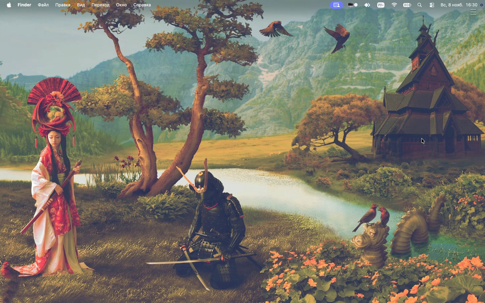
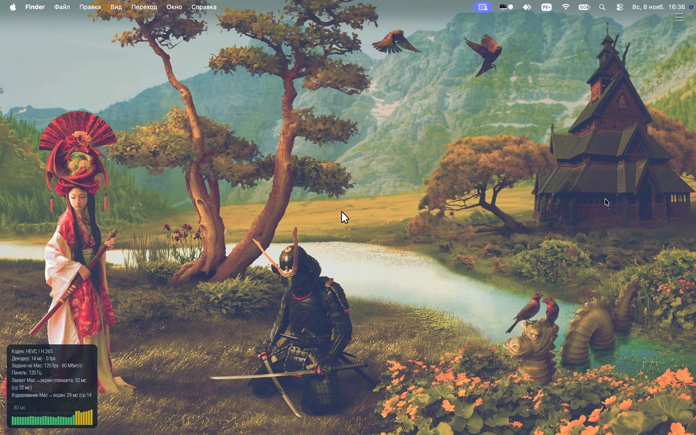
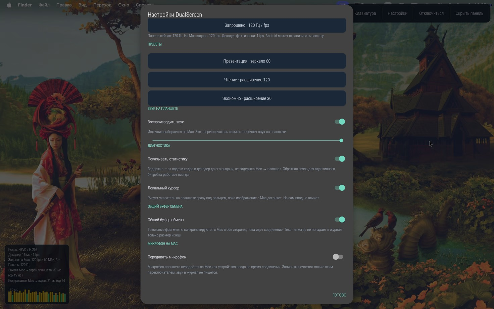

<div align="center">
  
  <h1>DualScreen</h1>
  <p><strong>Превратите Android-планшет во второй экран Mac по USB или Wi-Fi.</strong></p>
  <p>Расширение рабочего стола и зеркало · звук и микрофон · буфер обмена · управление с планшета</p>
  <p>
    <a href="https://github.com/oproskyrin/DualScreenPOI/releases/latest"></a>
    <a href="https://github.com/oproskyrin/DualScreenPOI/actions/workflows/release.yml"></a>
    
    
    <a href="#license"></a>
  </p>
  <p>
    <a href="https://github.com/oproskyrin/DualScreenPOI/releases/latest"><strong>Скачать для Mac и Android</strong></a>
    &nbsp; · &nbsp; <a href="#быстрый-старт">Быстрый старт</a>
    &nbsp; · &nbsp; <a href="#faq">Вопросы и ответы</a>
  </p>

  
</div>

---

Перетащите на планшет редактор, документы или окно чата. В режиме расширения macOS видит отдельный дисплей; в режиме зеркала планшет показывает основной экран. Приложения остаются на Mac, Android-клиент принимает изображение и звук и передаёт ввод обратно.

**Проверенная связка:** Mac с Apple Silicon и Lenovo **Xiaoxin Pad Pro 12.7 (2023), TB371FC**. Другие Android-устройства пока не проверены: Android 8+ и аппаратный HEVC-декодер — минимальные требования, а не гарантия совместимости.

<p align="center">
  <a href="#возможности">Возможности</a> ·
  <a href="#загрузка">Загрузка</a> ·
  <a href="#быстрый-старт">Быстрый старт</a> ·
  <a href="#подключение">Подключение</a> ·
  <a href="#звук">Звук и микрофон</a> ·
  <a href="#буфер-обмена">Буфер обмена</a> ·
  <a href="#обновления">Обновления</a> ·
  <a href="#faq">Вопросы и ответы</a>
</p>

<a id="возможности"></a>
## Возможности

| | Что доступно |
|---|---|
| Рабочий стол | Расширение и зеркало; переключение режима, разрешения и частоты из меню Mac или настроек Android |
| Пресеты | Кнопки **«Презентация»** (зеркало 60), **«Чтение»** (расширение 120) и **«Экономно»** (30) — одним касанием |
| Retina | По умолчанию **1472×920 точек → 2944×1840 пикселей** на проверенном планшете |
| Расположение | Хост запоминает положение второго дисплея и восстанавливает его после перезапуска; справа размещает только при первом запуске |
| USB и Wi-Fi | Проводное подключение через встроенный `adb`; поиск Mac по Wi-Fi через mDNS, выбор компьютера или ручной адрес |
| Звук | Отдельный системный выход «Xiaoxin Pad Pro 12.7», системная громкость и mute; звук передаётся только при выборе этого выхода |
| Микрофон | Микрофон планшета появляется на Mac как устройство ввода — для звонков и диктовки. Включается тумблером и передаётся только во время соединения |
| Буфер обмена | Двусторонняя синхронизация текста между Mac и планшетом, пока идёт сеанс |
| Сенсорный ввод | Тап, перетаскивание, прокрутка двумя пальцами, правый клик долгим нажатием и экранная клавиатура |
| Клавиатура и тачпад | Физические клавиши и сочетания (Meta → ⌘, Alt → ⌥, Ctrl → ⌃), кнопки мыши, перетаскивание и двухосевая прокрутка |
| Вибро и панель | Короткая вибрация при подключении и обрыве; скрываемая панель и полупрозрачная перетаскиваемая кнопка **☰** с сохранением положения |
| Диагностика | Оверлей по звеньям с NTP-синхронизацией часов и **живым графиком задержки**: захват Mac → экран планшета, кодирование → экран, декодер мс/fps, транзит ввода, сдвиг часов и RTT |
| Кодек | HEVC (H.265) по умолчанию, H.264 (AVC) — по выбору; сервер и планшет согласуют формат при подключении |

**Задержка на проверенном планшете** (TB371FC, USB, Retina 2944×1840, HEVC): «захват Mac → экран планшета» — **25–30 мс**, ввод планшет → Mac — ~6 мс, полный путь «касание → пиксель» — ~55–60 мс. Это уровень Sidecar и Moonlight на хорошем железе.

<table>
  <tr>
    <td></td>
    <td></td>
  </tr>
  <tr>
    <td align="center"><em>Оверлей диагностики: числа по звеньям и живой график</em></td>
    <td align="center"><em>Настройки клиента: пресеты, буфер обмена, микрофон</em></td>
  </tr>
</table>

Хост запрашивает **120 fps по умолчанию**. На статичном контенте macOS отдаёт кадры только при изменениях — счётчик FPS декодера тогда показывает 0–40, и это не потеря плавности: во время движения поток доходит до ~100 fps. Счётчик FPS — пропускная способность кодированных кадров, а не подтверждённые 120 отображённых кадров/с. Метрики оверлея измеряют звенья: «захват → экран» включает захват, кодирование, сеть, декод и рендер; «ввод» — только путь события планшет → Mac.

<a id="загрузка"></a>
## Загрузка

Откройте [последний опубликованный релиз](https://github.com/oproskyrin/DualScreenPOI/releases/latest) и скачайте оба файла:

| Устройство | Файл из релиза | Состав |
|---|---|---|
| Mac с Apple Silicon | `DualScreen-vX.Y.Z-macos-arm64.pkg` | Приложение, USB-компонент `adb` и аудиодрайвер DualScreenAudio |
| Android-планшет | `DualScreenClient-vX.Y.Z.apk` | Клиент для Android 8+ с аппаратным HEVC-декодером |

Новые версии публикуются на странице последнего релиза; номера файлов соответствуют версии. Архив `DualScreenHost-…tar.gz` с отдельным бинарным файлом не заменяет установщик. ZIP приложения предназначен для обновлений, не для первой установки со звуком.

> **О подписи macOS.** Приложение использует локальную подпись, установщик не подписан Developer ID и не нотарифицирован Apple. Gatekeeper может заблокировать открытие — при необходимости используйте штатную кнопку **Open Anyway** в «Конфиденциальности и безопасности». Не отключайте Gatekeeper или SIP.

<a id="быстрый-старт"></a>
## Быстрый старт

1. Установите `.pkg` на Mac и `.apk` на планшет (подробности — [ниже](#install)).
2. Подключите планшет кабелем, разблокируйте его и разрешите отладку по USB для своего Mac.
3. На планшете нажмите **«Подключить по USB»** — картинка появится сама.
4. В Системных настройках Mac перетащите дисплеи так, как удобно, — расположение запомнится.
5. Выберите «Xiaoxin Pad Pro 12.7» как выход звука, если хотите слушать звук на планшете.
6. Перетащите нужное окно на экран планшета — работайте.

Три пресета в настройках клиента меняют режим и частоту одним касанием: **«Презентация»** — зеркало и 60 fps для показа экрана, **«Чтение»** — расширение и 120 fps, **«Экономно»** — 30 fps для батареи.

<a id="install"></a>
## Установка

### 1. Mac

Понадобятся **macOS 13+**, **Apple Silicon**, права администратора и перезагрузка для установки аудиодрайвера. Полный установщик не предназначен для Intel Mac. Homebrew, Xcode и отдельная установка `adb` пользователю не нужны.

1. Скачайте `.pkg` из релиза и откройте его. Он устанавливает:
   - `/Applications/DualScreen.app` — приложение со встроенным `adb`;
   - `/Library/Audio/Plug-Ins/HAL/DualScreenAudio.driver` — системный аудиокомпонент;
   - `/Library/Application Support/DualScreenAudio/` — лицензию, сведения об изменениях и соответствующие исходники драйвера.
2. Подтвердите установку в штатном диалоге macOS и **перезагрузите Mac**, когда предложит установщик. Перезагрузка нужна для HAL-драйвера.
3. Откройте **DualScreen** из «Программ» или Spotlight. Управление находится в **строке меню**; значка в Dock нет по замыслу.
4. Разрешите запись экрана в **Системные настройки → Конфиденциальность и безопасность → Запись экрана** (название раздела зависит от macOS). Для мыши, клавиатуры и касаний также разрешите **Универсальный доступ**. Если macOS просит перезапустить приложение, выполните это.
5. При запросе доступа к локальной сети разрешите его для подключения по Wi-Fi. Автостарт при входе можно включить в меню приложения.

Если macOS блокирует пакет или приложение, сначала проверьте источник скачивания. Только если доверяете файлу, используйте штатную кнопку **«Всё равно открыть» / Open Anyway** в разделе «Конфиденциальность и безопасность», если она доступна. Не отключайте Gatekeeper или SIP.

### 2. Android

1. Скачайте `.apk` из того же релиза и откройте его на планшете. Android может попросить разрешить установку из выбранного браузера или файлового менеджера.
2. Запустите **DualScreen**. Для USB включите параметры разработчика и **отладку по USB**.
3. На Android 13+ разрешите уведомления, если хотите возвращаться к сеансу из шторки. Отказ не мешает соединению, но скрывает уведомление.

<a id="подключение"></a>
## Подключение

### USB

1. Запустите DualScreen на Mac и подключите планшет кабелем с передачей данных.
2. Разблокируйте планшет и подтвердите **разрешение отладки по USB для этого Mac**. Разрешайте постоянное доверие только своему компьютеру.
3. Хост настраивает соединение через встроенный `adb`. При необходимости откройте клиент и нажмите **«Подключить по USB»**; вводить `localhost` вручную не нужно.

### Wi-Fi

1. Подключите Mac и планшет к одной доверенной сети и запустите хост.
2. На Android нажмите **«Найти Mac по Wi-Fi»**, затем выберите компьютер из списка. Поиск сам не подключается к первому найденному Mac.
3. Если mDNS недоступен, введите адрес Mac вручную: `IP:7381`. Последний Wi-Fi-адрес сохраняется отдельно от USB.

> **В протоколе пока нет пейринга, аутентификации и шифрования.** Устройство с сетевым доступом к TCP-порту хоста может попытаться подключиться и получить трансляцию или передать ввод. Используйте только сеть с доверенными участниками; не открывайте порт 7381 в интернет и не подключайтесь через публичный Wi-Fi. Само название «домашняя сеть» не гарантирует безопасность.

### Во время работы

- Переместите дисплей планшета в настройках дисплеев macOS. Хост запомнит расположение.
- Меняйте режим, разрешение и запрашиваемую частоту кадров из меню Mac или настроек клиента.
- **Пресеты** в настройках клиента: «Презентация», «Чтение», «Экономно» — режим и частота одним касанием.
- Нажмите **«Скрыть панель»**, чтобы оставить только кнопку **☰** без подложки и рамки. Её можно перетащить; нажатие снова раскрывает панель.
- Нажмите тихое уведомление DualScreen в шторке Android, чтобы вернуться к текущему сеансу. Оно не меняет Mac и не создаёт новое подключение; после завершения процесса клиента восстановление через уведомление не гарантируется.
- **«Отключиться»** и **«Отменить подключение»** останавливают автоматические повторы. Новое подключение запускается кнопкой пользователя.

<a id="input"></a>
### Физическая клавиатура и тачпад

Подключите устройства ввода к Android, включите **«Клавиатура и тачпад»** в настройках клиента и щёлкните по нужному окну Mac на изображении. Ввод передаётся при активной трансляции и фокусе на изображении; меню и диалоги клиента остаются на Android.

| Клавиша на Android | Модификатор на Mac |
|---|---|
| Meta | Command ⌘ |
| Alt | Option ⌥ |
| Ctrl | Control ⌃ |

Передаются нажатия, отпускания и повторы, кнопки мыши и прокрутка. При потере фокуса или соединения клиент освобождает удерживаемые клавиши и кнопки. Сочетания и жесты, зарезервированные Android, могут не дойти до Mac.

<a id="codec"></a>
## Кодек: HEVC и H.264

Клиент сообщает серверу список поддерживаемых декодеров, сервер отвечает фактически выбранным кодеком; согласованный формат виден в настройках клиента и в оверлее диагностики. По умолчанию — **HEVC**, при явном выборе в настройках или отсутствии поддержки — **H.264 (AVC)**. Смена кодека переподключает сеанс; старый сервер без согласования считается HEVC.

Замер на Lenovo TB371FC по USB, 2944×1840, движение через тракт ввода:

| Метрика оверлея | HEVC | H.264 |
|---|---|---|
| Декодер | 6–8 мс · 96–105 fps | 217 мс · 72 fps |
| Захват Mac → экран | 25–36 мс | 291–331 мс |
| Кодирование → экран | 9–14 мс | 195–237 мс |

На этом планшете H.264-декодер работает существенно медленнее HEVC, поэтому HEVC остаётся значением по умолчанию, а H.264 — резерв для устройств без поддержки HEVC. Поведение на других моделях не измерялось. Метрики заканчиваются передачей кадра в рендер и не равны задержке «палец → пиксель»; методика — в [docs/codec-negotiation.md](docs/codec-negotiation.md).

<a id="звук"></a>
## Звук и микрофон

Полный `.pkg` включает **DualScreenAudio**, собственный HAL-драйвер на основе BlackHole. Отдельно ставить BlackHole или создавать составное аудиоустройство не нужно.

**Выход** называется «Xiaoxin Pad Pro 12.7»:

| Выбранный системный выход Mac | Куда идёт звук |
|---|---|
| Xiaoxin Pad Pro 12.7 | На планшет, когда соединение активно |
| Динамики Mac или другой выход | На выбранный выход; передача на планшет прекращается |

Системные громкость и mute регулируют передаваемый звук. Медиа-громкость Android дополнительно влияет на динамики планшета.

**Микрофон** (с версии 1.6.0) работает в обратную сторону: включите тумблер **«Передавать микрофон»** в настройках клиента — и на Mac появится устройство ввода с тем же именем. Оно доступно, только пока идёт соединение, и пропадает при отключении или запуске клиента. Запись начинается только по явному включению тумблера с разрешением Android; аудио в журналы не пишется.

<a id="буфер-обмена"></a>
## Буфер обмена

Пока идёт сеанс, текст синхронизируется автоматически в обе стороны: скопировали на Mac — вставляйте на планшете, и наоборот. Синхронизируется только текст (до 1 МБ за фрагмент); изображения и файлы не переносятся. Тумблер **«Общий буфер обмена»** выключает синхронизацию. Текст буфера никогда не попадает в журналы.

<a id="updates"></a>
## Обновления

В меню Mac есть **«Проверить обновления…»**. Приложение использует Sparkle **2.10.1**: проверка обновлений включена, а загрузка и установка требуют подтверждения пользователя. Лента и архив приложения проверяются по подписи **Ed25519**. Эта подпись защищает канал обновлений, но не заменяет Developer ID и нотарификацию Apple.

| Обновление | Как устанавливается |
|---|---|
| Только приложение | Через Sparkle, без замены HAL-драйвера и без повторной установки системного аудиокомпонента; настройки и расположение дисплея сохраняются отдельно от приложения |
| Аудиодрайвер или микрофон | Новым полным `.pkg`, с правами администратора и перезагрузкой |
| Android-клиент | Новым `.apk` из релиза |

Канал `macos-updates` служит для ленты обновлений, а не для первой установки. При обновлении приложения активная трансляция прерывается и восстанавливается автоматически.

<a id="limitations"></a>
## Совместимость и ограничения

- Проверенная модель — **Lenovo Xiaoxin Pad Pro 12.7 (2023), TB371FC**, не Legion. Совместимость остальных Android-планшетов и их HEVC-декодеров пока не подтверждена.
- Полный установщик рассчитан на **Apple Silicon, macOS 13+**. Заявленный минимум macOS не означает испытаний на каждой версии системы.
- Расширение использует приватный API `CGVirtualDisplay`, который Apple может изменить. Одновременно обслуживается один клиент.
- На Retina-разрешении 2944×1840 устойчиво передаётся ~55–60 fps; запрос 120 fps даёт более плавные движения, но добавляет задержку — пресеты позволяют выбрать баланс.
- Пейринг и защита сетевого протокола ещё не реализованы. USB требует разрешённой отладки на Android.
- Портретная ориентация на лету, полноценная обработка сна Mac, давление/наклон стилуса и HDR пока не реализованы.
- Микрофон планшета появляется на Mac только во время активного соединения; это поведение намеренное.

<a id="faq"></a>
## Вопросы и ответы

<details>
<summary><strong>Почему приложение открыто, но его нет в Dock?</strong></summary>

DualScreen работает в строке меню. Само приложение установлено в `/Applications/DualScreen.app` и доступно через Finder и Spotlight. Проверьте также разрешение записи экрана; для управления Mac нужен «Универсальный доступ».

</details>

<details>
<summary><strong>USB не подключается. С чего начать?</strong></summary>

Проверьте кабель с передачей данных, разблокируйте планшет, включите отладку по USB и подтвердите доверие к Mac. Убедитесь, что клиент установлен, а хост запущен. Затем нажмите «Подключить по USB». Homebrew и ручная установка `adb` для полного `.pkg` не нужны.

</details>

<details>
<summary><strong>Mac не находится по Wi-Fi?</strong></summary>

Устройства должны видеть друг друга в локальной сети. Гостевая изоляция, VPN, запрет локальной сети или фильтрация mDNS могут мешать поиску. Попробуйте ручной адрес `IP:7381` и проверьте разрешения приложения в macOS. Не открывайте порт в интернет ради подключения.

</details>

<details>
<summary><strong>Почему нет звука или выхода планшета?</strong></summary>

Убедитесь, что установлен полный `.pkg`, Mac перезагружен после установки драйвера, хост запущен и клиент подключён. Выберите «Xiaoxin Pad Pro 12.7» в системном меню звука; проверьте mute и громкость на обеих сторонах. Выбор динамиков Mac намеренно останавливает передачу звука на планшет.

</details>

<details>
<summary><strong>Как включить микрофон планшета?</strong></summary>

Настройки клиента → **«Передавать микрофон»**. Android запросит разрешение на запись — разрешите. На Mac появится устройство ввода «Xiaoxin Pad Pro 12.7»; выберите его в источниках ввода (Zoom, OBS и т. д.). Устройство доступно только во время соединения и исчезает после отключения. Запись выключается тем же тумблером.

</details>

<details>
<summary><strong>Буфер обмена не синхронизируется?</strong></summary>

Синхронизируется только текст, пока идёт соединение, и только если включён тумблер «Общий буфер обмена». Переносятся фрагменты до 1 МБ. На Android чтение буфера ограничено системой: клиент должен быть на переднем плане. Если скопировали в другом приложении планшета — вернитесь в DualScreen, и текст уйдёт на Mac.

</details>

<details>
<summary><strong>Изображение есть, но задержка выросла?</strong></summary>

Проверьте оверлей диагностики (Настройки → «Показывать статистику»). Если «захват Mac → экран» сильно выше 30–40 мс — закройте тяжёлые приложения на Mac или переключитесь на пресет «Экономно» (30 fps). Хост также снижает битрейт при перегрузке сети и возвращает его автоматически. Журналы: Mac — `~/Library/Logs/DualScreen/host.log`, Android — «Настройки → Журнал соединения».

</details>

<details>
<summary><strong>Где взять журналы для отчёта об ошибке?</strong></summary>

На Mac: `~/Library/Logs/DualScreen/host.log` и `host.log.1`. На Android: **Настройки → Журнал соединения**; файлы `connection.log` и `connection.log.1` находятся в `Android/data/com.oleg.dualscreen/files/logs/` (Android может ограничивать доступ).

На каждой стороне журнал ротируется между двумя файлами размером до **512 КиБ каждый**. В нём есть время, попытки и причины разрывов; введённый текст, коды клавиш, кадры, аудио и содержимое буфера обмена не записываются. Перед публикацией просмотрите журнал на личные сведения, например адреса устройств.

Сообщите модель планшета, версии macOS/Android и приложений, USB или Wi-Fi, шаги воспроизведения. Создать отчёт можно в [Issues](https://github.com/oproskyrin/DualScreenPOI/issues).

</details>

<a id="architecture"></a>
## Как это устроено

```text
Mac                                             Android
┌────────────────────────────────┐               ┌───────────────────────────┐
│ Виртуальный дисплей / зеркало   │   HEVC-видео  │ MediaCodec → SurfaceView  │
│ ScreenCaptureKit → VideoToolbox ├──────────────►│                           │
│ Системный звук → PCM            ├──────────────►│ AudioTrack                │
│ Микрофонный HAL ← PCM           │◄──────────────┤ AudioRecord (микрофон)    │
│ CGEvent                        │◄──────────────┤ Касания, клавиатура, мышь  │
│ NSPasteboard ← → Clipboard      │◄─────────────►│ ClipboardManager          │
└────────────────────────────────┘  ввод / статы  └───────────────────────────┘
                    TCP 7381 · DSXP v1
              USB: adb reverse · Wi-Fi: mDNS / IP
```

Протокол DSXP v1: фрейм `[u8 type][u32 BE len][payload]`; `0x00` — control JSON (включая удалённые команды setMode/setLogical/setFps), `0x01` — Annex-B HEVC с VPS/SPS/PPS в ключевых кадрах, `0x02` — input JSON, `0x03` — статистика с NTP-синхронизацией, `0x04` — PCM16LE 48 кГц стерео (выход), `0x05` — тайминги задержки, `0x06` — буфер обмена, `0x07` — микрофон планшета.

<a id="development"></a>
## Разработка

Для сборки нужны macOS с Command Line Tools и совместимым Swift toolchain, Python 3; для Android — JDK 17, Gradle и Android SDK 35. Это требования разработчика, не пользователя готового установщика.

```bash
# Хост и Android-клиент
(cd host && swift build -c release)
(cd android && gradle assembleRelease test lint --no-daemon)

# Изолированные регрессионные проверки Mac
bash scripts/test-host-audio.sh
bash scripts/test-host-layout.sh
bash scripts/test-host-server.sh
bash scripts/test-host-input.sh
bash scripts/test-host-app.sh
bash scripts/test-host-audio-presence.sh
bash scripts/test-host-codec.sh
bash scripts/test-host-mic.sh
bash scripts/test-host-bitrate.sh
bash scripts/test-host-clipboard.sh

# После актуальной release-сборки хоста: smoke-тест без дисплея и TCC
python3 scripts/test-host-app-smoke.py

# Проверки логики упаковки и публикации, без самой публикации
python3 -m unittest discover -s tests -v
```

Проверки звука с установленными устройствами запускаются отдельно: `bash scripts/test-host-audio.sh --devices`. Они **временно меняют системный выход и громкость**, затем восстанавливают их. Изолированные тесты и smoke-проверка не доказывают установку, выданные разрешения, работу физического ввода или сквозное обновление.

<details>
<summary><strong>Собрать полный установщик и исходники аудиодрайвера</strong></summary>

Сначала подготовьте checkout BlackHole на commit, закреплённом в `scripts/build-dualscreen-audio.sh`, либо используйте соответствующие исходники уже собранного драйвера:

```bash
BLACKHOLE_SOURCE=/path/to/BlackHole bash scripts/build-dualscreen-audio.sh          # выход
BLACKHOLE_SOURCE=/path/to/BlackHole bash scripts/build-dualscreen-audio.sh --mic    # микрофон
bash scripts/build-macos-app.sh --version X.Y.Z
DUALSCREEN_TEST_ARTIFACTS=dist/macos python3 -m unittest discover -s tests -p test_macos_packaging.py -v
```

Аудиокомпоненты и полные архивы исходников появятся в `dist/DualScreenAudio/` и `dist/DualScreenMic/`; приложение, полный `.pkg` и ZIP для обновлений — в `dist/macos/`. Сборка сама ничего не устанавливает, не перезапускает CoreAudio и не публикует релиз.

Упаковщику нужны настоящий публичный ключ Sparkle, его framework и лицензия, а также переносимый `adb` с `NOTICE.txt`. Приватный ключ подписи обновлений в репозиторий не входит. Подробности и параметры: [packaging/macos/README.md](packaging/macos/README.md).

</details>

<details>
<summary><strong>Параметры CLI-хоста</strong></summary>

```text
--mirror            зеркало вместо расширения
--logical WxH       логическое разрешение (1472x920 / 1920x1200 / 2944x1840)
--fps N             запрашиваемые кадры/с (120 / 90 / 60)
--bitrate N         потолок битрейта, Мбит/с (по умолчанию 60)
--port N            TCP-порт (по умолчанию 7381)
```

CLI и архив отдельного бинарного файла предназначены для разработки. Для обычной установки используйте полный `.pkg`.

</details>

<a id="license"></a>
## Лицензии

Основное приложение DualScreen распространяется под **[MIT](LICENSE)**. Отдельные HAL-компоненты **DualScreenAudio** и **DualScreenMic**, основанные на BlackHole, распространяются под **GPL-3.0**; лицензия основного приложения не заменяет лицензию драйверов.

С драйверами поставляются исходная лицензия, `NOTICE.txt` с изменениями и атрибуцией, точный upstream commit (`UPSTREAM_SHA`), полный архив соответствующих исходников **`*-source.tar.gz`** и инструкция сборки. Установщик размещает их в `/Library/Application Support/DualScreenAudio/`. Архив включает исходники upstream, модифицированные файлы и скрипт воспроизводимой процедуры сборки; его достаточно для повторной сборки без отдельного checkout BlackHole. Это не обещание побитово одинакового пакета при разных версиях инструментов.

Лицензии Sparkle и USB-компонента `adb` также включены в приложение.
