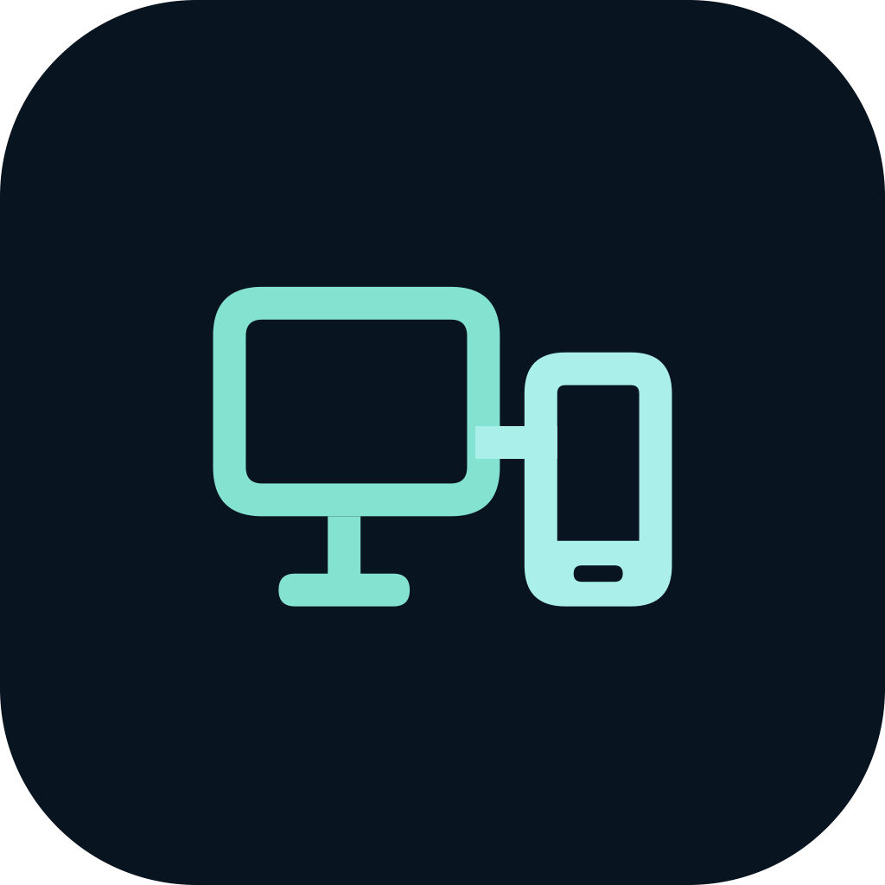
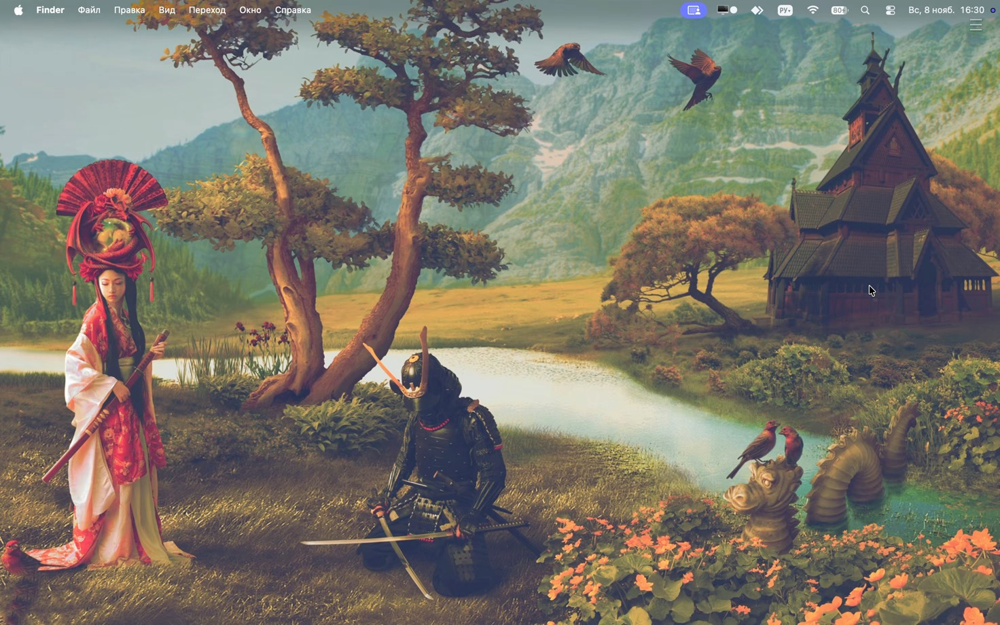
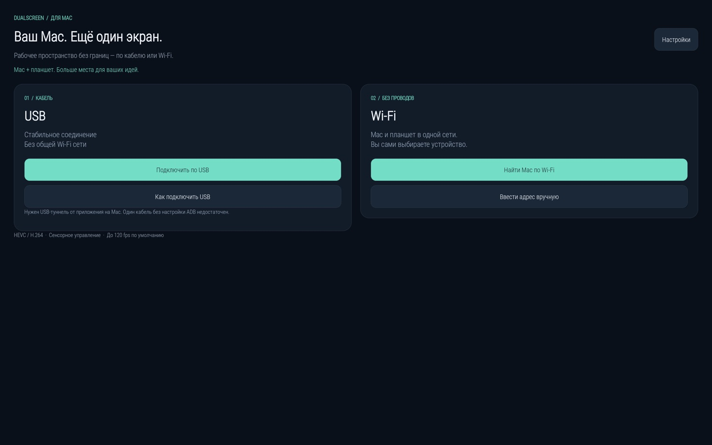
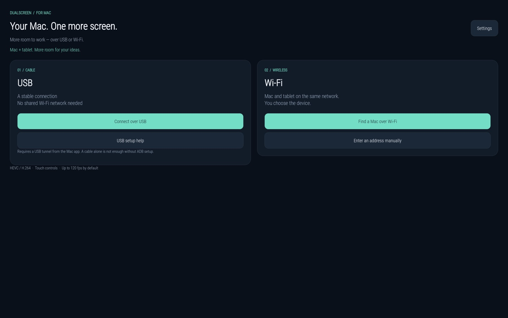
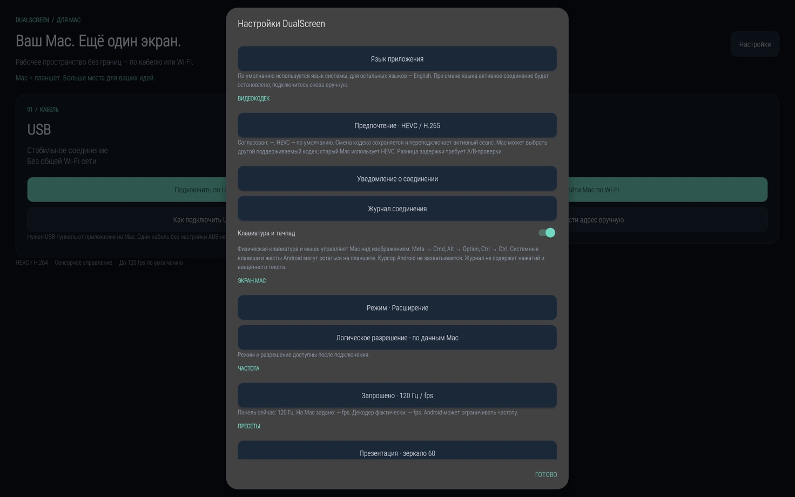
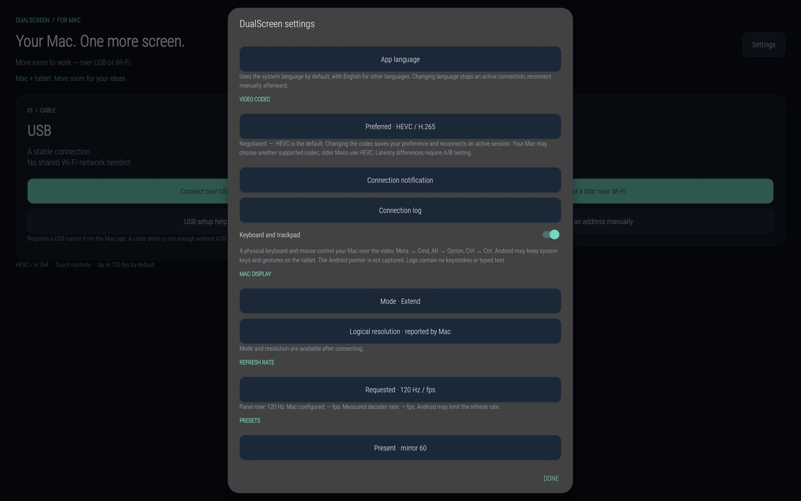
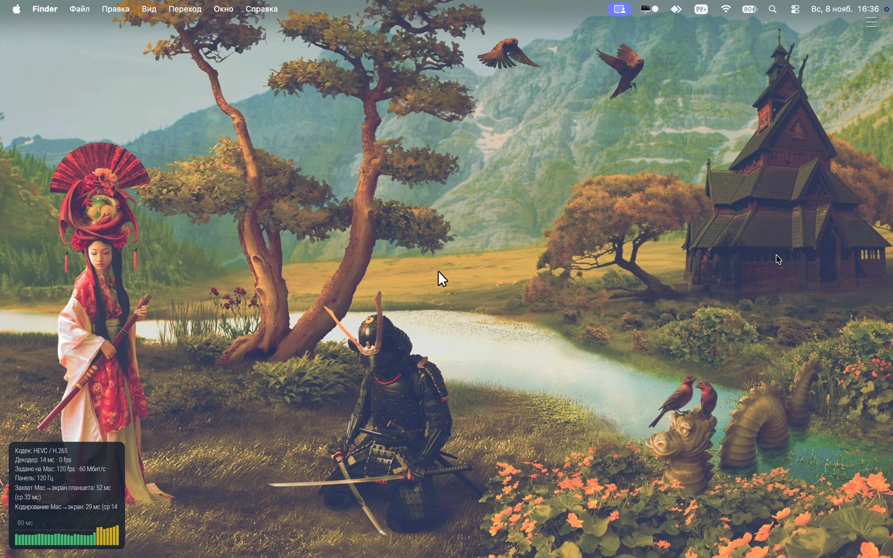
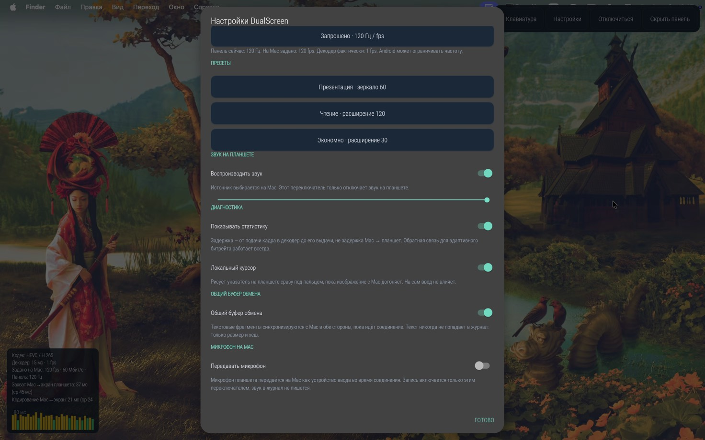

  
  <h1>DualScreen</h1>
  
<strong>Android-планшет как второй экран Mac.</strong>

  
Расширение и зеркало по USB или Wi-Fi · звук · клавиатура и касания · текстовый буфер · микрофон планшета

  
<a href="README.md">English</a> · <strong>Русский</strong>

  
<a href="https://github.com/oproskyrin/DualScreenPOI/releases/latest"><strong>Скачать для Mac + Android</strong></a> · <a href="#quick-start">Быстрый старт</a> · <a href="#feedback">Рассказать о своём устройстве</a>

  
  
<em>Трансляция рабочего стола со скрытой панелью клиента. Это снимок экрана, а не фотография планшета.</em>

**Публичная бета.** Проверенная связка — Mac с Apple Silicon и **Lenovo Xiaoxin Pad Pro 12.7 (2023), TB371FC**. Заявленные минимумы — **macOS 13+** и **Android 8+**, а не перечень испытанных версий ОС и устройств. Другим планшетам нужна проверка сообществом. Работайте только в сети с доверенными участниками: в протоколе трансляции **нет пейринга, аутентификации и шифрования**.

### Языки интерфейса

Начиная с **v1.7.0**, обе платформы включают **русский и английский в одном приложении**. По умолчанию каждый аппарат следует собственным языковым настройкам системы; резервный язык — английский. На Android: **Настройки → Язык приложения → Системный / Русский / English**. Смена языка останавливает сеанс — после неё подключитесь заново. Хост Mac следует системному языку или отдельной языковой настройке приложения в macOS.

<strong>Скриншоты русского и английского интерфейса</strong>

| Русский | English |
|---|---|
|  |  |
|  |  |

Настоящие снимки с планшета из отдельной тестовой копии клиента; для этих кадров соединение и запись микрофона не запускались.

[Возможности](#features) · [Установка](#installation) · [USB / Wi-Fi](#connection) · [Ввод](#input) · [Звук / микрофон](#audio) · [Буфер обмена](#clipboard) · [Производительность](#performance) · [Решение проблем](#troubleshooting) · [Участие в разработке](CONTRIBUTING.md)

## Возможности

Перетащите на планшет редактор, справочный документ или окно чата. Приложения работают на Mac; Android-клиент получает изображение и звук и передаёт ввод обратно.

| Возможность | Что доступно |
|---|---|
| Рабочий стол | Расширение или зеркало; режим, разрешение и запрашиваемая частота кадров меняются на Mac и Android |
| Расположение | Сохраняется положение дополнительного дисплея; справа он размещается при первом запуске |
| HiDPI | Целевой режим проверенного планшета: 1472×920 логических точек / 2944×1840 физических пикселей буфера |
| Подключение | USB через встроенный `adb`; Wi-Fi с поиском mDNS или ручным адресом `IP:7381` |
| Видео | HEVC по умолчанию, H.264 как согласуемая альтернатива; совместимость аппаратных декодеров зависит от устройства |
| Ввод | Касания, перетаскивание, прокрутка двумя пальцами, правый клик долгим нажатием, экранная и физическая клавиатуры, мышь/тачпад |
| Звук | Отдельный выход планшета на Mac с системными громкостью и mute |
| Буфер обмена | Только текст, с ограничениями Android на чтение при отсутствии фокуса |
| Микрофон | Передача с планшета на Mac по желанию; нужны микрофонный HAL-драйвер и разрешение Android |
| Управление | Скрываемая панель, перетаскиваемая кнопка **☰**, пресеты и оверлей диагностики |

<table>
  <tr>
    <td></td>
    <td></td>
  </tr>
  <tr>
    <td><em>Диагностика и история показаний — иллюстрация интерфейса, а не результат бенчмарка. Слово «экран» в подписи не означает измерение физической задержки дисплея.</em></td>
    <td><em>Настройки Android: пресеты, воспроизведение, диагностика, буфер и микрофон. На снимках русский интерфейс; подписи зависят от версии.</em></td>
  </tr>
</table>

## Быстрый старт

1. На [странице релиза](https://github.com/oproskyrin/DualScreenPOI/releases/latest) скачайте полный **`DualScreen-vX.Y.Z-macos-arm64.pkg`** и **`DualScreenClient-vX.Y.Z.apk`**.
2. Установите пакет Mac, перезагрузитесь по запросу и откройте **DualScreen** из «Программ». Приложение работает в **строке меню**, а не в Dock.
3. Разрешите **запись экрана** и **универсальный доступ**, как описано ниже. Установите и откройте APK на Android.
4. Для USB включите **отладку по USB**, подключите кабель с передачей данных, разблокируйте планшет и разрешите доступ своему Mac. В клиенте нажмите **«Подключить по USB»**.
5. Расположите дисплеи в настройках macOS и перетащите окно на планшет. Для звука на планшете выберите выход **Xiaoxin Pad Pro 12.7** на Mac.

Предпочитаете Wi-Fi? В одной доверенной локальной сети нажмите **«Найти Mac по Wi-Fi»** и выберите компьютер. Отладка по USB для Wi-Fi не нужна.

## Установка и разрешения

### Mac

Полный пакет рассчитан на **Apple Silicon / macOS 13+**; для системных аудиокомпонентов нужны права администратора и перезагрузка. Intel не является поддерживаемой целью полного установщика. Пользователю не нужны Homebrew, Xcode или отдельная установка BlackHole/`adb`.

Текущая сборка полного пакета включает:

- `/Applications/DualScreen.app` со встроенными `adb` и обновлением через Sparkle;
- `/Library/Audio/Plug-Ins/HAL/DualScreenAudio.driver` — выход на планшет;
- `/Library/Audio/Plug-Ins/HAL/DualScreenMic.driver` — микрофон планшета;
- лицензии, уведомления и соответствующие исходники драйверов в `/Library/Application Support/DualScreenAudio/` и `/Library/Application Support/DualScreenMic/`.

ZIP приложения или старый архив отдельного хоста **не заменяет полную первую установку**. В ранее установленных пакетах микрофонного драйвера может не быть; обновление приложения его не добавляет.

В **Системные настройки → Конфиденциальность и безопасность** разрешите:

- **Запись экрана** (название раздела зависит от macOS) для видео;
- **Универсальный доступ** для мыши, клавиатуры и касаний;
- **Локальную сеть**, если система запросит доступ для соединения/поиска.

Закройте и откройте приложение заново, если macOS попросит. При смене подписи, особенно у ad-hoc сборок, после обновления может потребоваться повторная выдача разрешений.

> **О подписи:** не рассчитывайте на подпись Apple Developer ID или нотарификацию. По умолчанию сборщик создаёт ad-hoc подписанное приложение и неподписанный установщик; сборки сопровождающего могут использовать локальную подпись. Приём файла Gatekeeper на другом Mac не гарантирован. Проверьте источник и используйте штатную кнопку **«Всё равно открыть» / Open Anyway**, только если доверяете файлу и кнопка доступна. Не отключайте Gatekeeper или SIP и не устанавливайте чужой локальный сертификат ради обхода защиты. Подпись обновления Sparkle — не нотарификация Apple.

### Android

Установите APK из того же релиза. Android может запросить разрешение установки из браузера или файлового менеджера. Для USB нужны параметры разработчика → **отладка по USB** и доверие своему Mac. На Android 13+ разрешение уведомлений позволяет возвращаться к сеансу из шторки, но не обязательно для соединения. Доступ к микрофону запрашивается при включении его передачи.

APK сейчас подписывается debug-ключом среды сборки. Сборки из разных сред могут не обновляться поверх друг друга. Не удаляйте приложение без необходимости: удаление стирает настройки клиента. При несовпадении подписей сообщите источники старого и нового APK, а не обходите проверку подписи.

## USB и Wi-Fi

**USB:** запустите Mac-приложение, подключите кабель с передачей данных, разблокируйте планшет и подтвердите доверие. Хост настраивает `adb reverse` для TCP 7381 через встроенный `adb`. При необходимости откройте клиент и нажмите **«Подключить по USB»**; вводить `localhost` не нужно. Разрешайте отладку только на компьютерах, которые контролируете.

**Wi-Fi:** запустите хост в той же доверенной локальной сети. Нажмите **«Найти Mac по Wi-Fi»** и выберите компьютер; поиск не выбирает первый результат автоматически. Если mDNS заблокирован, введите `IP:7381` своего Mac. Гостевая изоляция, VPN, межсетевой экран и разрешения локальной сети могут мешать. Адреса USB и Wi-Fi сохраняются отдельно.

**Граница безопасности:** USB не добавляет аутентификацию DSXP и не обязательно выключает сетевой listener. Участник сети с доступом к порту хоста может попытаться получить трансляцию, передать ввод, текст буфера или микрофонные данные. Не пробрасывайте TCP 7381 в интернет и избегайте публичных/общих сетей. Подробнее: [SECURITY.md](SECURITY.md).

Панель клиента содержит настройки, клавиатуру и отключение. **«Скрыть панель»** оставляет перетаскиваемую кнопку **☰**; касание возвращает панель. **«Отключиться»** и **«Отменить подключение»** останавливают повторы до нового подключения пользователем. Уведомление Android возвращает к существующему сеансу; восстановление после завершения процесса не гарантируется.

## Клавиатура, касания и указатель

Подключите клавиатуру/мышь/тачпад к **Android**, включите **«Клавиатура и тачпад»** в настройках клиента и передайте фокус изображению Mac. На Mac нужен универсальный доступ. Диалоги и поля клиента сохраняют ввод Android.

| Модификатор Android | Модификатор Mac |
|---|---|
| Meta | Command ⌘ |
| Alt | Option ⌥ |
| Ctrl | Control ⌃ |

Передаются нажатия, отпускания, повторы, кнопки мыши и двухосевая прокрутка. При потере фокуса/соединения удерживаемый ввод сбрасывается. Зарезервированные Android сочетания и жесты могут не попасть на Mac. Сенсорный ввод поддерживает тап, перетаскивание, прокрутку двумя пальцами и правый клик долгим нажатием. Экранная клавиатура открывается кнопкой панели. Локальный курсор — визуальная обратная связь, а не доказательство обработки события Mac.

## Звук и микрофон планшета

### Звук Mac → планшет

После полной установки HAL и запуска хоста выберите **Xiaoxin Pad Pro 12.7** как выход Mac. При соединении звук пойдёт на планшет. Выбор динамиков Mac или другого выхода прекращает передачу; одновременного вывода на оба устройства нет. На слышимость влияют системные громкость/mute и медиа-громкость Android. Проверьте также тумблер воспроизведения клиента.

### Микрофон планшета → Mac

1. Установите **полный пакет с `DualScreenMic.driver`** и перезагрузитесь по запросу. Sparkle/обновление только приложения не добавляет системный драйвер.
2. В настройках Android включите **«Передавать микрофон»** (по умолчанию выключено) и разрешите доступ к микрофону.
3. Если включили после установления соединения, **отключитесь и подключитесь заново**: возможность микрофона объявляется в hello, поэтому текущий сеанс может не принимать только что включённый звук.
4. Выберите **Xiaoxin Pad Pro 12.7** как **вход** в macOS или принимающем приложении. Это отдельное устройство от одноимённого выхода. Разрешите принимающему Mac-приложению доступ к микрофону, если оно запросит.

Запись прекращается при выключении тумблера или разрыве; настройка включения сохраняется и может возобновить запись при следующем соединении. Доступность HAL-устройства следует за **процессом Mac-хоста**, а не тумблером или сеансом Android: наличие входа не доказывает запись или поступление звука. PCM микрофона в журналы соединения не записывается. [Протокол и реализация](docs/mic-0x07.md).

## Текстовый буфер: ограничение Android

Синхронизация по умолчанию включена для поддерживающих её сторон и отключается в настройках клиента. Передаётся **только текст до 1 МиБ в UTF-8**, не изображения и файлы. Не копируйте секреты во время общего сеанса.

**Mac → Android** — проверенное обычное направление. **Android → Mac не является неограниченным фоновым мостом:** Android 10+ разрешает чтение буфера приложению с фокусом. Копирование в другом приложении отнимает фокус DualScreen, а возвращение в DualScreen **не гарантирует повторную отправку**: текущая реализация слушает изменения и не перечитывает буфер явно при возобновлении. Нужно доступное для чтения изменение при фокусе DualScreen. Не рассчитывайте на бесшовный сценарий «скопировать — переключиться — вставить» в этом направлении. [Подробности](docs/clipboard-sync.md).

## Производительность: что означают числа

В **ограниченном USB-тесте на TB371FC** с HEVC, буфером 2944×1840 и запросом 120 fps метрика захвата в оверлее показывала примерно **25–30 мс**. Это историческое наблюдение, **не обещание задержки** и не сравнительный тест устройств.

Начало метрики — **callback ScreenCaptureKit**, конец — около Android **`MediaCodec.releaseOutputBuffer`**, то есть передачи декодированного кадра поверхности. Она **не измеряет** захват до callback, очереди композитора/презентации, физическую развёртку панели или путь «касание → пиксель». Транзит ввода заканчивается разбором сообщения сервером, а не ответом приложения. Нельзя складывать пересекающиеся интервалы оверлея или добавлять предполагаемую задержку дисплея ради вычисления полного пути.

Точность также ограничена синхронизацией часов и FIFO-сопоставлением кадров, особенно при пропусках. Используйте движущийся источник, серию показаний и фиксированную конфигурацию, а не один снимок. [Границы метрик и сравнение кодеков](docs/codec-negotiation.md).

Хост по умолчанию запрашивает **120 fps**, но не гарантирует 120 физически отображённых кадров в секунду. На статике ScreenCaptureKit может выдавать мало кадров. Запрошенные FPS, режим виртуального дисплея, частота панели Android и пропускная способность декодера — разные величины. H.264 — альтернатива, а не гарантированное ускорение; HEVC остаётся основным.

## Решение проблем и обновления

| Симптом | Что проверить сначала |
|---|---|
| Чёрный экран / нет изображения | Хост запущен; запись экрана разрешена для этой подписи; перезапуск после смены разрешений; переподключение |
| Картинка есть, ввода нет | Универсальный доступ; тумблер ввода; фокус изображения, а не диалога клиента |
| USB недоступен | Кабель с данными, разблокировка, отладка USB, доверие Mac, установленный клиент |
| Пустой поиск Wi-Fi | Доверенная общая подсеть; изоляция/VPN/firewall/mDNS; ручной `IP:7381` без открытия порта наружу |
| Нет звука планшета | Полный HAL-пакет и перезагрузка; хост запущен; выбран выход Mac; громкость/mute и воспроизведение клиента |
| Нет микрофонного входа / тишина | Mic HAL установлен; перезагрузка после пакета; разрешение и тумблер Android; переподключение после включения; выбор входа Mac |
| Задержка выросла | Движущийся источник, разрешение/кодек, нагрузка и транспорт; сравнение серий, а не застывших чисел |

В меню Mac выберите **«Проверить обновления…»**. Sparkle проверяет наличие версий, но загрузка/установка требуют подтверждения. Проверка Ed25519 ленты/архива не заменяет доверие Apple Developer ID. Обновления только приложения не меняют системные HAL-драйверы; добавление/обновление драйверов требует полного пакета и прав администратора/перезагрузки. Android обновляется APK из релиза. После смены подписи проверьте разрешения заново.

Журналы: Mac — `~/Library/Logs/DualScreen/host.log` и `host.log.1`; Android — **Настройки → Журнал соединения**, файлы в `Android/data/com.oleg.dualscreen/files/logs/`, если доступны. Записываются метаданные соединения и размеры/хеши буфера, но не текст буфера, видео/аудио, введённый текст или коды клавиш. **Просмотрите и обезличьте журналы и снимки перед публикацией**: метаданные могут идентифицировать устройства и сеть.

### Известные ограничения

- Один подключённый клиент; подтверждён TB371FC, а не широкий список планшетов/версий ОС.
- Дополнительный дисплей использует приватные API `CGVirtualDisplay`, которые Apple может изменить.
- Нет защищённого пейринга/аутентификации/шифрования, HDR, давления/наклона стилуса и полной обработки сна/ориентации.
- Действуют ограничения фокуса буфера Android и особенности декодеров/ввода конкретных устройств.

## Помогите проверить бету

**Работает на вашем планшете? Расскажите — даже если всё хорошо.** Откройте [отчёт о совместимости](https://github.com/oproskyrin/DualScreenPOI/issues/new?template=device-compatibility.yml): точная модель, версии ОС/приложений, USB/Wi-Fi и проверенные функции. Для неисправностей есть [отчёт об ошибке](https://github.com/oproskyrin/DualScreenPOI/issues/new?template=bug-report.yml). Принимаются русский и английский. Приглашение к тестированию не означает подтверждённую совместимость.

Публикуйте только свои снимки, проверенные на личные данные рабочего стола. Уязвимости отправляйте через [приватный процесс](SECURITY.md), а не публичную ошибку.

## Сборка и участие

Команды сборки/тестов и правила изменений — в [CONTRIBUTING.md](CONTRIBUTING.md), требования установщика — в [документации упаковки macOS](packaging/macos/README.md), протоколы — [кодеки](docs/codec-negotiation.md), [буфер](docs/clipboard-sync.md), [микрофон](docs/mic-0x07.md). Успешная сборка/тест не доказывает установку, выдачу разрешений или работу реального устройства.

## Лицензии

Основное приложение — **[MIT](LICENSE)**. Оба отдельных HAL-драйвера на основе BlackHole, **DualScreenAudio и DualScreenMic**, — **GPL-3.0**. Каждый включает лицензию, описание изменений/атрибуцию, закреплённый upstream commit, полный архив соответствующих исходников (`*-source.tar.gz`) и инструкцию сборки в своей папке Application Support. MIT не отменяет обязательства GPL для драйверов. Уведомления Sparkle и `adb` поставляются с приложением.
